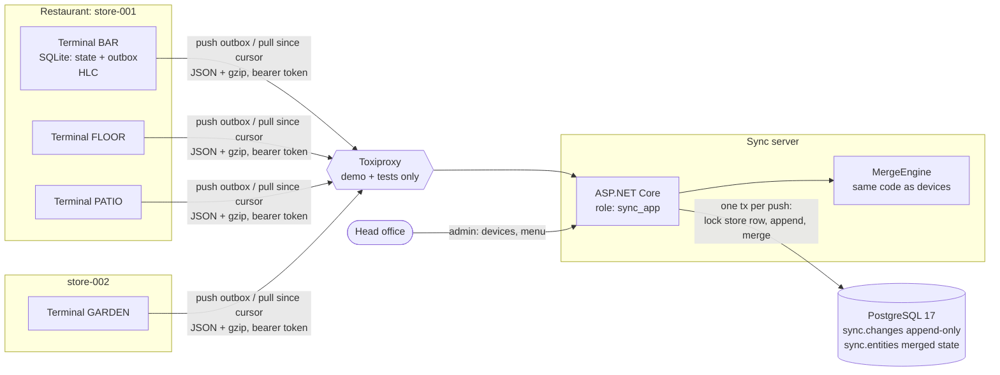

# offline-pos-sync

[](https://github.com/hekimcan206/offline-pos-sync/actions/workflows/ci.yml)
[](https://github.com/hekimcan206/offline-pos-sync/actions/workflows/codeql.yml)


[](LICENSE)

An offline-first sync engine for restaurant point-of-sale terminals. SQLite runs on each terminal and PostgreSQL on the
server. Writes are ordered by hybrid logical clocks, and conflicts are merged deterministically per field: last-writer-wins
registers, counters, and forward-only state machines for order tickets. The promise: **a restaurant whose internet
drops never loses a ticket**, and when the link comes back every terminal ends with the same state as the server.

> All data is synthetic: menus, tickets and terminals are generated. There is no real personal, payment or business
> data, and the design is generic, not modelled on any existing product.

## Problem

A restaurant keeps selling when the uplink dies. That gives a sync engine three problems at once:

1. **Durability without the server.** The ticket must be safe the moment the cashier taps "send to kitchen". A crash,
   a reboot or a dead battery must not lose it, and the server may be unreachable for hours.
2. **Exactly once over a hostile network.** Requests time out after the server committed. Responses get cut. Retries
   race each other. A slow request is overtaken by a newer one. Each change must be stored once, and every terminal
   must eventually receive every change.
3. **Conflicts that a cashier cannot resolve.** Two terminals edit the same ticket while offline: both tap "+1", one
   takes payment while the other voids the ticket, someone adds a dessert after the bill was paid. "Last write wins"
   silently loses a quantity or erases a paid sale. Asking staff to pick a version on a Friday night is not an option.
   And "last" is itself unreliable when terminal clocks are wrong.

## Solution

| Concern | How |
|---|---|
| Durable local writes | SQLite (WAL, `synchronous=FULL`). One transaction writes the merged entity state, the applied change id and the **outbox** row, so a ticket survives a crash before any sync ([ADR 0003](docs/adr/0003-sync-protocol-op-log-outbox-and-store-sequencer.md)) |
| Ordering | **Hybrid logical clocks** (Kulkarni et al., 2014), packed into one sortable 64-bit value. Causality survives slow clocks, timestamps stay readable. A drift guard rejects clocks from the future ([ADR 0001](docs/adr/0001-hybrid-logical-clocks-for-ordering.md)) |
| Conflicts | One merge engine with **row LWW**, **field-level LWW** and **domain rules**: quantities are counters, ticket status is a forward-only lattice where *paid outranks voided*, line voids are forward-only, prices are captured. Review flags are derived from converged state ([ADR 0002](docs/adr/0002-merge-strategies-field-registers-and-domain-lattices.md)) |
| Exactly once | Change ids are minted on the device. The server's unique index arbitrates (`INSERT … ON CONFLICT (change_id) DO NOTHING`), and a stored body hash catches a replayed id with altered content |
| Never skip on pull | The store row is the sequencer. A push locks it (`FOR UPDATE`), so sequence order equals commit order, and a pull reads head and page in one snapshot |
| Partial sync | Scope = the device's store (from its token), plus an entity subscription (a kitchen display skips the menu). The menu is server-authored only ([ADR 0004](docs/adr/0004-partial-sync-scope-and-authority.md)) |
| Proof | 17 conflict scenarios (generated table), FsCheck properties for HLC and convergence, a property test of the real device stack under random faults, Toxiproxy partition / blackhole / cut-response / latency / flapping / reordering tests against PostgreSQL ([ADR 0006](docs/adr/0006-fault-injection-and-property-testing.md)) |
| Demo | `docker compose up`: four terminals sell through a partition and a flapping link, then the simulator proves convergence and zero loss ([ADR 0005](docs/adr/0005-demo-client-console-simulator-over-expo.md)) |

## Architecture



A cashier rings up an order while the link is down, and later the link returns:

```mermaid
sequenceDiagram
    participant C as Cashier
    participant D as Terminal (SQLite)
    participant S as Sync server
    participant P as PostgreSQL
    C->>D: add line, +1, send to kitchen
    D->>D: BEGIN; HLC.Now(); merge into state;<br/>insert applied id + outbox row; COMMIT (fsync)
    Note over D: link down: push fails, outbox keeps growing,<br/>sync loop backs off with full jitter
    D->>S: POST /sync/push (oldest 100 outbox rows)
    S->>P: BEGIN; SELECT head FROM stores FOR UPDATE
    S->>P: INSERT changes … ON CONFLICT (change_id) DO NOTHING RETURNING
    S->>P: load touched states, merge fresh changes, upsert, bump head; COMMIT
    S-->>D: accepted / duplicates / rejected, server HLC
    Note over S,D: response lost? the retry returns "duplicates":<br/>nothing is applied twice
    D->>D: delete acknowledged outbox rows, HLC.Observe(server)
    D->>S: GET /sync/pull?since=cursor
    S-->>D: page of changes (seq order) + cursor
    D->>D: apply unseen ids with the same MergeEngine, advance cursor (one tx)
```

### Why this design

- **One merge implementation, run everywhere.** The terminal, the server and the property tests all call
  `MergeEngine`. Convergence depends on every replica merging identically, so there is exactly one copy of the rules.
  The schema version is checked on every push.
- **Semilattices instead of "latest wins" wherever latest loses money.** Every rule is max-by-stamp, max-by-rank or a
  sum over unique deltas, so state is a function of the *set* of changes. The order and number of deliveries do not
  matter. That is what makes retries, reordering and partitions harmless rather than special cases.
- **Terminals are authoritative for selling; the server is authoritative for structure.** Unlike server-authoritative
  sync layers (PowerSync, Replicache), the server never vetoes a business write, because the terminal must be able to
  sell with no server at all. It does reject malformed, out-of-scope and future-stamped changes.
- **Plain numbers as cursors.** Locking the store row makes the per-store sequence safe without logical replication
  or snapshot watermarks. The cost (serial pushes per store) is measured below and is far above what one restaurant
  produces.

## Conflict scenarios

Every row runs on three replicas (server, T1, T2) under in-order and reverse delivery, and all replicas must end with
byte-identical state. The full table, generated from the test catalogue and golden-tested, is in
[docs/conflict-scenarios.md](docs/conflict-scenarios.md). A summary:

| # | Input (T1 and T2 offline from each other) | Strategy | Outcome on every replica |
|---|---|---|---|
| S01 / S02 | T1 moves the table, T2 adds a note | RowLww / FieldLww | row LWW **loses the table move**; field merge keeps both |
| S05 | T2's clock is 10 min slow; it syncs, then edits | FieldLww | T2's later edit wins: the HLC carries causality |
| S06 / S07 | both tap "+1" on qty 1 | FieldLww / DomainRules | qty 2 (**one tap lost**) / qty 3 |
| S09 / S10 | T1 takes payment, T2 voids later | FieldLww / DomainRules | voided (**sale disappears**) / paid + flag `void_overridden_by_payment` |
| S11 | stale write tries to move status back to "open" | DomainRules | stays "sent": forward-only state machine |
| S12 | dessert added after the bill was paid | DomainRules | line kept and counted, flag `line_added_after_close` |
| S14 | both open a ticket for table 7 | DomainRules | two tickets kept, both flagged `duplicate_open_table` |
| S15 | head office changes a price while T1 sells offline | DomainRules | line keeps the price it was rung up at |
| S16 / S17 | lost ack → same change pushed twice; changes arrive reversed | DomainRules | applied once; same state as in-order |

## Quick start

```bash
docker compose up --build        # postgres, migrator, seed, server, toxiproxy, simulator
docker compose logs -f simulator # watch four terminals sell through a partition
```

Then, while the server keeps running:

- API reference (Scalar): <http://127.0.0.1:58280/scalar>
- merged tickets with review flags: `curl -H "X-Admin-Key: admin-dev-only" http://127.0.0.1:58280/api/v1/admin/stores/store-001/tickets`
- run the demo again: `docker compose run --rm simulator`
- clean up: `docker compose down -v`

Local development: `docker compose up -d postgres toxiproxy` and then `dotnet run --project src/PosSync.Server`
(uses `appsettings.Development.json`, migrates on startup). Tests: `dotnet test` (Docker must be running for the
integration suite).

### Demo output

The output of `docker compose up` on the development machine, with per-second status lines trimmed to one per phase:

```text
== offline-pos-sync simulator: all data is synthetic
== uplink http://toxiproxy:8666/ -> Toxiproxy 'terminal-link' -> server:8080
== menus synced: BAR=16 items, FLOOR=16 items, PATIO=16 items, GARDEN=16 items
[t+  0.0s] ---- ONLINE for 6 s
== table 42 opened on BAR and visible on FLOOR
[t+  6.1s] link UP        | BAR    on  outbox    0 tickets  31 | FLOOR  on  outbox    0 tickets  29 | PATIO  on  outbox    0 tickets  30 | GARDEN on  outbox    0 tickets  10 | server store-001 tickets 31
[t+  6.3s] ---- PARTITION for 10 s (Toxiproxy proxy disabled)
[t+  7.1s] link DOWN      | BAR    off outbox   11 tickets  33 | FLOOR  off outbox    5 tickets  32 | PATIO  off outbox    7 tickets  31 | GARDEN off outbox   10 tickets  12 | server store-001 tickets 31
== conflicts on table 42 while partitioned: BAR +1 and FLOOR +1 on the kebab, BAR pays, FLOOR voids, FLOOR adds a dessert
[t+ 16.1s] link DOWN      | BAR    off outbox   81 tickets  47 | FLOOR  off outbox   80 tickets  46 | PATIO  off outbox   76 tickets  44 | GARDEN off outbox   80 tickets  25 | server store-001 tickets 31
[t+ 16.3s] ---- FLAPPING for 4 s
[t+ 18.2s] link FLAP:UP   | BAR    on  outbox    0 tickets  85 | FLOOR  on  outbox    0 tickets  85 | PATIO  on  outbox    0 tickets  87 | GARDEN on  outbox    0 tickets  28 | server store-001 tickets 87
[t+ 20.8s] ---- HEALED: waiting for convergence
[t+ 21.8s] link UP        | BAR    on  outbox    0 tickets  99 | FLOOR  on  outbox    0 tickets  99 | PATIO  on  outbox    0 tickets  99 | GARDEN on  outbox    0 tickets  31 | server store-001 tickets 99

== RESULT
  store-001: 99 tickets rung up on 3 terminals, 99 of them on the server, 0 lost (server history: 99)
  store-002: 31 tickets rung up on GARDEN, 31 of them on the server, 0 lost; GARDEN holds no store-001 data
  convergence after heal: 1026 ms (all terminal hashes equal the server hash)
  table 42: status=paid, kebab qty=3 (1 + BAR +1 + FLOOR +1), total=1410.00 TRY
            flags for the manager: void_overridden_by_payment, line_added_after_close
  tickets from this run with review flags: 1 (void_overridden_by_payment, line_added_after_close)
SUMMARY {"converged":true,"convergenceMs":1026,"ticketsCreated":130,"ticketsOnServer":130,"lost":0,"table42":{"Status":"paid","kebabQty":3,"Flags":["void_overridden_by_payment","line_added_after_close"]},"failures":[]}
== PASS: no ticket lost, all replicas converged
```

## Results

Measured on a laptop: Intel Core i7-13620H (16 logical CPUs), 15.7 GB RAM, Windows 11, .NET 10.0.12, Docker Desktop
29.9 (VM with 7.6 GB RAM). The server and PostgreSQL ran in compose and the benchmark client on the host, with 5
containers running in total. Medians of 5 measured runs after one warm-up run. The full method, raw samples and
reproduction steps are in [docs/benchmarks.md](docs/benchmarks.md).

| Measurement | Result |
|---|---|
| Push throughput, 1 terminal (batches of 100) | **5 231 changes/s** |
| Push throughput, 4 terminals in 4 stores / in 1 store (contended row lock) | **18 007** / **7 051 changes/s** |
| Push throughput, 16 terminals in 16 stores | **26 999 changes/s** |
| Pull, fresh terminal, pages of 500 (1 store / 16 stores aggregate) | **12 536** / **65 284 changes/s** |
| Convergence after the partition heals, 3 terminals, 100 or 1 000 changes backlog each, default backoff (cap 2 s) | **1 527 ms** / **1 492 ms** (dominated by when the next retry fires) |
| Same, retry kicked on reconnect | **314 ms** / **493 ms** |
| Payload per change on the wire, batch of 100 (raw JSON / gzip as sent) | **342 B / 77 B** |
| Terminal write durable (one change, fsync), p50 / p99 | **1.28 / 2.77 ms** (whole 5-change ticket: 6.47 / 17.79 ms) |
| Merge one change (CPU), BenchmarkDotNet | **38-56 ns** |


## Testing

| Suite | Count | What it proves |
|---|---:|---|
| HLC examples + properties | 15 | strict monotonicity under backward clock steps, receive > received, bounded drift, restart safety, drift refusal |
| Merge convergence properties | 2 | any order + duplicates → byte-identical replicas, for all three strategies; serialisation round-trip mid-stream |
| Conflict scenarios | 19 | the 17 documented rows on 3 replicas × 2 delivery orders, plus the catalogue and golden-file checks |
| Change validation | 17 | malformed, out-of-scope and oversized input refused with stable codes |
| Device stack | 14 | crash durability, write-order outbox, HLC across reboot, lost-ack replay, duplicate pull pages, partial sync, clock skew, **property: random schedules of sales, link flaps, lost acks and skewed clocks → convergence, zero loss, exactly once** |
| Server (PostgreSQL) | 13 | convergence with server hash, replays and 12 concurrent first pushes, conflicting duplicates, scope, partial sync, read-only menu, append-only log privileges, pull cursor under 6 concurrent writers |
| Partition (Toxiproxy) | 6 | partition, blackhole, response cut after commit, latency beyond timeout, 6 s flapping link with resets, request reordering |
| **Total** | **86** | unit + property suite runs in about 5 s, integration suite in about 35 s |

Mutation sanity check: changing the register rule so that HLC ties are resolved by arrival order makes 3 property
tests and 4 conflict scenarios fail.

## Limitations and next steps

- **No store-local peer sync.** While the uplink is down, terminals in the same restaurant do not see each other's
  tickets. Nothing is lost, but the bar does not see the floor's orders until the link heals. A store hub, meaning a
  terminal or small box running the same protocol on the LAN, is the natural next step.
- **Rejected changes need an operator.** A change from a terminal whose clock was more than 5 minutes fast is kept as
  rejected on the device and is never deleted. Re-issuing it with a fresh stamp is a manual action with no tooling
  yet.
- **Unbounded history.** `sync.changes` and the device's applied-id set grow forever. Compaction (snapshot plus
  truncation below a horizon every device has passed) is not implemented.
- **Status cannot move backwards.** Reopening a paid ticket is modelled as a new ticket or a refund. A business that
  needs reopening needs a different lattice and a schema version bump.
- **Widening a subscription** (a kitchen display that starts showing the menu) requires resetting its cursor to 0.
- **Security in production** needs TLS at the ingress, an identity provider instead of the single admin key,
  per-device rate limiting, and encryption at rest on terminals (SQLCipher). See the
  [threat model](docs/threat-model.md).
- **Not measured here:** behaviour on real tablets and flash storage, a real Wi-Fi or LTE uplink, and multi-node server
  deployments. All numbers come from one laptop with the server in Docker.
- **The demo client is a console simulator, not a mobile app** ([ADR 0005](docs/adr/0005-demo-client-console-simulator-over-expo.md)).

## Privacy note (KVKK)

The data model holds no personal data: no customer names, phone numbers or card data, and `opened_by` is a terminal
id. If a deployment adds staff or customer identities, KVKK (Turkey's Personal Data Protection Law, No. 6698) and
GDPR apply: a data inventory, retention limits for the change log, and encryption on devices.

## Repository layout

```text
src/PosSync.Core         HLC, change model, schema, MergeEngine, ticket projection (shared by device and server)
src/PosSync.Device       SQLite store + outbox, sync client and loop, POS facade
src/PosSync.Server       ASP.NET Core sync server, PostgreSQL migrations, admin endpoints
src/PosSync.Chaos        minimal Toxiproxy client (tests, simulator, benchmarks)
samples/PosSync.Simulator  multi-terminal console demo
benchmarks/PosSync.Benchmarks  throughput, convergence, payload, latency, BenchmarkDotNet micro
tests/                   unit + property (FsCheck), integration (Testcontainers PostgreSQL + Toxiproxy)
docs/                    ADRs, conflict scenarios, threat model, benchmarks
```

## License

[MIT](LICENSE)
